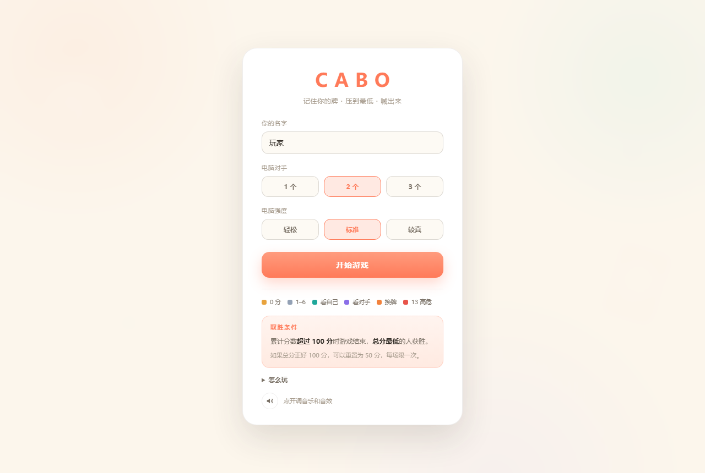
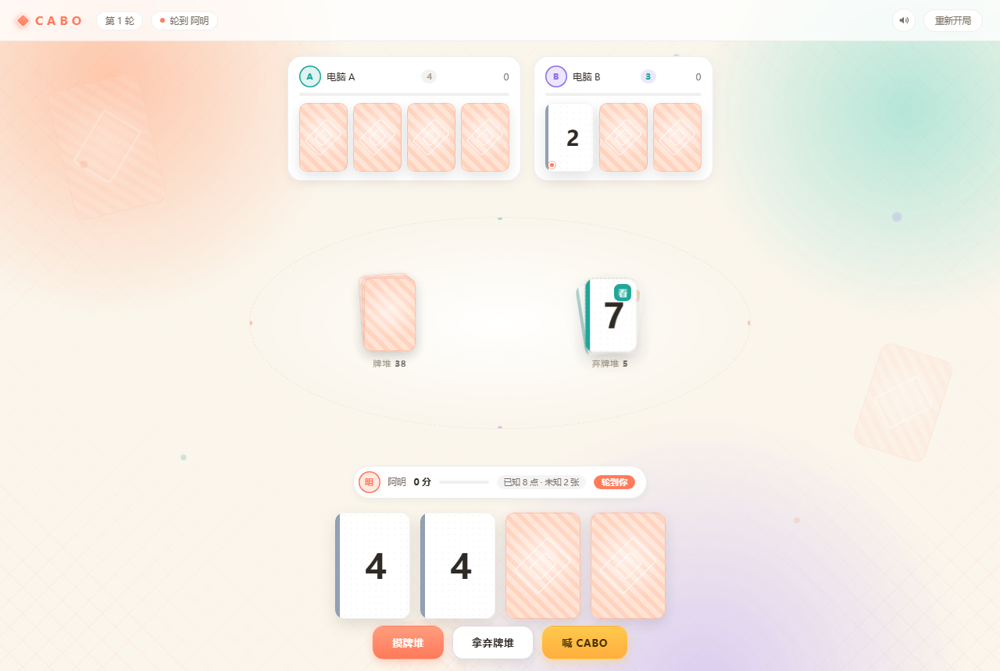

# CABO 卡波

一个双击就能玩的单机版 CABO 卡牌游戏。Go 编写，**双击直接弹出一个原生窗口**，不需要浏览器，也不需要安装任何运行时。

[](https://github.com/DHKTIG/Cabo/actions/workflows/ci.yml)
[](LICENSE)

| 开始界面 | 对局界面 |
|---|---|
|  |  |

## 直接玩

从 [Releases](https://github.com/DHKTIG/Cabo/releases) 下载 `cabo.exe`，双击即可；也可以照下面的「自己编译」自己构建。

| 参数 | 作用 |
|---|---|
| （无） | 原生窗口 |
| `-browser` | 改用系统浏览器打开（窗口起不来时的退路） |
| `-port 8848` | 固定端口，默认随机分配 |
| `-debug` | 窗口内可右键「检查元素」，并输出渲染自检日志 |
| `-log` | 请求日志写到 `%LOCALAPPDATA%\Cabo\cabo.log` |

窗口基于系统自带的 WebView2 运行时（Windows 11 和绝大多数 Windows 10 都有）。万一没有，程序会弹提示框并自动退回浏览器模式。

## 自己编译

需要 Go 1.22 以上（用到了 `go:embed`）。

```bash
go build -ldflags="-s -w -H windowsgui" -o cabo.exe ./cmd/cabo
```

- **`-H windowsgui` 必须加**，否则会附带一个黑色控制台窗口。
- 不需要 cgo，也不需要 gcc。
- 产物是单个约 7 MB 的 exe，前端 HTML/CSS/JS 和图标都已经嵌进去了，拷到别的 Windows 机器上直接能跑。
- 想调试就在构建时去掉 `-H windowsgui`，这样能看到控制台输出。

---

## 设计说明

### 为什么不用扑克牌

CABO 的核心信息只有两样：**这张牌值几分**，**它有没有技能**。花色在这个游戏里完全无用（原版里唯一的作用是"方块 K 算 0 分"，本质上是个特例）。

所以这副牌是重新设计的：**没有花色，没有 J/Q/K，只有数字**。牌面上只有三样东西——大号数字、左侧的色条、右上角的技能标。牌背是金色菱形纹样，和牌面同一套语言。

### 牌组构成

去掉花色后，用一张 0 替换掉其中一张 13，点数分布和原版**完全一致**：

| 数字 | 张数 |
|---|---|
| 0 | 3 |
| 1–12 | 各 4 |
| 13 | 3 |

总张数 54，总点数 351，平均 6.5 分——和一副标准扑克（含两张王、方块 K 记 0）一模一样。

### 颜色编码

浅奶油底让白卡片浮起来，珊瑚橘做唯一的主强调色，红只留给 13 分高危牌。

| 颜色 | 含义 |
|---|---|
| 琥珀金 | 0 分，最值钱的牌 |
| 石板灰 | 1–6，普通低牌 |
| 青 | 7–8，透视（看自己） |
| 紫 | 9–10，窥探（看对手） |
| 橙 | 11–12，置换（换牌） |
| 珊瑚红 | 13，高危 |

背景用奶油色而不是赌桌绿——绿桌布是赌场扑克的刻板印象，CABO 是记忆桌游，不是赌场游戏。背景上叠了三团缓慢漂移的柔光（蜜桃、薄荷、薰衣草）和几颗浮动的小点，让整页不至于是一块死板的纯色。

### 页面元素

一局牌需要的信息比看起来多，所以每个位置都带了自己的状态：

- **顶栏**：轮次胶囊 + 「轮到 某某」指示器（圆点用该玩家的颜色）
- **每个座位**：彩色头像（取名字最后一个字，方便区分「电脑 A/B/C」）、分数、一条 0–100 的进度条
- **自己**：胶囊式状态条，同样带头像、分数和进度条
- **中央**：牌堆叠层、待处理牌的专属位置、弃牌堆，底下垫一圈虚线椭圆当作桌面

### 动效

对局信息不再堆在侧边栏，全部**就地反馈**：

- 发牌：卡片从上方依次落入，带 45ms 错峰
- 翻牌：3D 翻转（`rotateY`），牌变可见时触发
- 弃牌：弃牌堆顶新牌旋转落入
- 摸牌：牌堆数量变化时轻微弹跳
- 洗牌：牌堆摸空时，牌从弃牌堆飞回牌堆、牌墩搓动两下，并在牌堆上方挂一条说明
- 行动：在对应玩家位置浮出胶囊提示（"弃掉 7" / "换走 2 · 出 2 张"）
- 技能：被指向的那张牌做一次抬升脉冲
- CABO：金色气球字「CABO」从喊话者座位正中弹起
- 回合：当前行动的座位呼吸光晕，自己回合显示"轮到你"徽章
- 连击：自己的名条上挂一枚会升级的连击标识，涨一档弹一下、音高上一阶
- 结算：回顾卡逐张错峰揭开，然后分数条从左向右生长、数字滚动累加

每个玩家有自己的主题色（珊瑚 / 薄荷 / 薰衣草 / 琥珀），头像、进度条、行动光晕、思考小点都跟着这个颜色走，扫一眼就知道谁是谁。

### 累积式反馈

单步反馈之外，还要让人看见自己在变好：

- **连击**：连续把**自己已知的牌**换成更小的，就攒一段连击。判定只认证据——安置到没看过的牌位算中性（既不奖励也不惩罚试探），换了张更大的或记错牌立刻归零。连击标识分四档换色（2/3/5/7），音效沿五声音阶逐级往上爬。
- **生涯记录**：单轮最低点数、最长连击、零失误轮数、喊 CABO 的胜率，**跨启动保留**（和音量设置同一个理由：WebView2 每次随机端口，localStorage 会归零，所以落在 `%LOCALAPPDATA%\Cabo\stats.json`）。顶栏一条常驻，破纪录时结算会给一张金卡。
- **回合回顾**：结算不再只是四行数字。每轮从本轮事件里挑最多 4 件值得说的事，做成回顾条——谁喊的 CABO 赌赢还是赌输、谁一手甩掉三张、谁用置换动了你的牌、你记错几次、中途洗了几次牌、有没有零失误。只用你本来就看得见的信息，暗牌面额不会漏进回顾。

### 对手行动的节奏

人机对战时如果每一步瞬间完成，观感会很差——玩家看不清"发生了什么"。这里参考了棋牌类手游的做法，做了三件事：

1. **飞牌**：对手摸牌时，一张牌背从牌堆沿弧线飞向他的座位；弃牌时，牌从座位飞向弃牌堆；用置换技能时，两张牌对向飞出。落点用 Web Animations API 计算，不需要 FLIP 布局。
2. **先飞牌再更新状态**：动画播完才切换画面。所以"牌飞过去"和"牌落到堆里"是先后关系，而不是同时发生——这是顺序感的来源。
3. **思考态**：每次行动前停 0.8–1.1 秒，名字旁出现三个跳动的小点。已经摸完牌、正在决定怎么处理时停得更久。

代价是单步变慢，但换来的是玩家能跟上节奏。想调快改 `runAI()` 里的 `wait` 即可。

### 声音

配乐和音效**都是运行时合成的，不含任何音频素材文件**，所以成品仍然是一个 exe、完全离线可用。

背景是一段 D 大调三拍子圆舞曲，用音乐盒、木琴质感的拨弦和沙锤搭出来的。刻意选 3/4 而不是 4/4：四四拍加反拍很容易把气氛推向赌场或酒吧，而这个游戏是围着桌子转的记忆游戏。旋律也不是粘贴循环的固定音轨，而是每小节按当前和弦在几组动机里摇出来的，所以听感是一首曲子在不断变奏。

音乐会跟着局势走：平时是完整编制的 100 BPM；有人喊了 CABO、或有人逼近 100 分时换成更紧的一档（旋律降八度、加底鼓脉冲、去掉沙锤）；开局界面和结算时退回稀疏的音乐盒。

音效覆盖所有动手的地方：按钮的轻点、选牌与退选、翻牌的纸声、摸牌和弃牌的甩牌声与落堆声、牌堆摸空时那一串洗牌的纸响、置换时两张牌左右交叉掠过的声音、透视与窥探各自的音色、记错的闷响、连击时逐级升高的五声音阶、喊 CABO 时那一记上扬，以及结算时回顾卡逐张揭开的轻钟。顶栏的喇叭图标可以分别调音乐和音效的音量，设置会被记住。

### 按钮状态

之前悬停金色按钮会整块变黑、字看不见——原因是 `.btn:hover` 的 `background` 优先级高于 `.btn.primary`，把金色渐变整个覆盖掉了，而文字颜色还是深棕。

现在改成用 CSS 变量分层：基类只负责 `background: var(--btn-bg)`，各变体只覆盖变量，只有一条 hover 规则。悬停是上浮 + 扫光，按下是下沉 + 变暗，不会再互相打架。

所有动画都尊重 `prefers-reduced-motion`，系统开了"减少动态效果"时会全部降级为瞬时。

---

## 玩法

每人 4 张暗牌，开局只能看 2 张，之后全靠记忆。目标是把手上点数压到最低，然后喊 CABO。

**回合三选一**

1. **摸牌堆** —— 摸到的牌可以弃掉、换进手牌、或发动技能。
2. **拿弃牌堆顶** —— 明牌，可以 1 换 1，也可以一次换出手上两张同数字的牌只吃进一张（手牌会因此变少，这是主要降分手段）。
3. **喊 CABO** —— 其他人各再行动一次，然后摊牌。

**技能牌**

| 数字 | 技能 |
|---|---|
| 7 / 8 | 透视：看自己一张暗牌 |
| 9 / 10 | 窥探：看对手一张暗牌 |
| 11 / 12 | 置换：交换场上任意两张牌 |

**计分**

喊 CABO 的人点数最低得 0 分；喊了但不最低，点数 +10；其他人按手牌点数全额计。累计超过 100 分结束，总分最低者获胜。总分恰好 100 时可以重置为 50（一场限一次）。

完整规则和版本差异见 [`docs/CABO-玩法详解.md`](docs/CABO-玩法详解.md)。

### 电脑强度

开局可以选三档。三档的区别只在决策参数，**不靠作弊**——AI 只能看到自己有权知道的信息，也不会偷看牌堆。

| 档位 | 行为 |
|---|---|
| 轻松 | 四张牌全记住且点数很低才喊 CABO，几乎不做置换，回合偏长、压力小 |
| 标准 | 敢在只剩一张未知牌时赌一把；会把自己的高牌塞给领先者；会吃进弃牌堆的低牌来降分 |
| 较真 | 更早喊、更爱换，盯住总分最低的人打 |

实测每回合每人的行动次数（2 人局，各 300 局）：轻松 23.9、标准 14.0、较真 10.7。

## 本项目采用的规则决策

CABO 没有唯一权威规则，各版本互相矛盾。本项目固定了以下选择（第二版为主）：

| 规则点 | 采用 |
|---|---|
| 开局看牌 | 自选 2 张，看完位置不可变 |
| 技能映射 | 7/8 看自己，9/10 看对手，11/12 交换 |
| 从弃牌堆拿的牌 | 保持明牌 |
| 1 换多的判定 | 换出的牌**彼此**同点（不是与被拿走的牌同点） |
| 1 换多上限 | 3 张 |
| 翻错惩罚 | 收下弃牌堆顶牌；涉及 ≥3 张再罚抽 1 张 |
| 弃牌堆拿牌触发技能 | 不触发，只有摸牌堆才触发 |
| 喊 CABO 后 | 其他人各行动一次，喊者手牌锁定不可被换 |
| 平局 | 喊者胜 |
| 牌堆摸空 | 把弃牌堆洗回牌堆继续，弃牌堆上留一张明牌 |
| 两堆都空 | 才结束本轮计分（实际对局几乎碰不到） |
| 100 分重置 | 恰好 100，一场限一次 |
| 超过 100 分 | 打满整轮再结算 |

未实现：神风特攻队（两张 12 + 两张 13）彩蛋、线上版的 Burn 抢牌机制。两者都在引擎之外，加进来不需要动核心规则。

## 项目结构

```
cabo/
├── cmd/cabo/main.go            入口：起服务、开浏览器
├── internal/
│   ├── engine/                 规则引擎（纯函数，零 I/O）
│   │   ├── card.go             牌、点数、技能判定、牌组构成
│   │   ├── state.go            对局状态、发牌、推进、结算
│   │   ├── rules.go            Apply：唯一的规则入口
│   │   ├── event.go            结构化事件，驱动前端动画
│   │   ├── view.go             视角裁剪，防止暗牌泄漏
│   │   └── rules_test.go
│   ├── ai/                     AI 对手
│   ├── server/                 HTTP + 内嵌静态资源
│   │   ├── server.go
│   │   └── static/             前端（编译时嵌入）
└── docs/
```

**关键设计：`internal/engine` 不 import 任何外部包，不碰网络、文件、时钟。** 所有随机性通过注入的 `*rand.Rand` 提供，所以任何一局都能用 seed 精确重放。

**事件机制**：引擎在每次状态变化时写入结构化 `Event`（谁、做了什么、涉及哪张牌、指向哪个位置），服务端只投递一次后清空。前端据此播放动画，而不是解析文字日志——这也是为什么对局信息可以完全离开侧边栏。

## 测试

```bash
go test ./...
```

四层测试：

1. **规则单元测试**（`internal/engine`）—— 逐条覆盖 1 换多、翻错惩罚、CABO 计分、平局、牌堆摸空后把弃牌堆洗回来、两堆都空才结算等边界。
2. **AI 对局守恒测试**（`internal/ai`）—— 让 4 个 AI 用 60 个不同种子互相对打，每步断言「牌堆 + 弃牌堆 + 所有手牌 + 待安置牌 = 54」。这条断言抓出过两个真实 bug：换出的牌没进弃牌堆。
3. **HTTP 端到端测试**（`internal/server`）—— 通过真实接口打完整一局，验证没有非法状态、没有死循环、结束时分数最高者确实超过 100 且赢家是最低分。
4. **持久化测试**（`internal/server`）—— 音量和生涯记录的读写往返与合并规则（0 点是有效记录而不是空值、越界输入折回、连击为 0 不占用「有记录」）。

每次 push 到 `main` 都会在 GitHub Actions 上跑 `go vet` / `go test` / 构建，见 [`.github/workflows/ci.yml`](.github/workflows/ci.yml)；构建产物可以直接从 Actions 的 Artifacts 里下载。

## 已知限制

- 单机版只维护一局游戏，开两个窗口会互相干扰。
- AI 是启发式的：会记自己看过的牌、会赌、会干扰领先者，但不算概率，也不做心理战。
- 没有对局存档，关掉窗口这一局就没了（跨局保留的只有生涯记录和音量设置）。
- 只在 Windows 上验证过（依赖系统自带的 WebView2 运行时）。

## 许可

[MIT](LICENSE)
